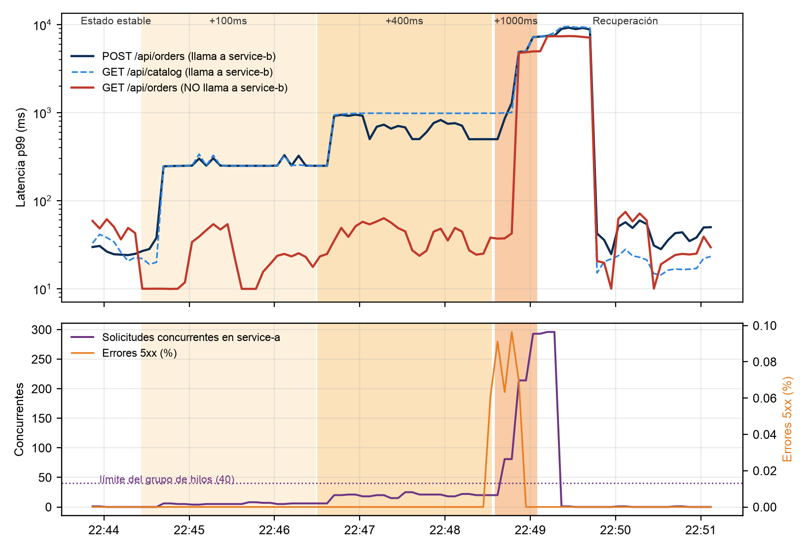

# LAB · Plan de Game Day (Chaos Engineering)

Plan de Game Day sobre el sistema del laboratorio anterior ([`OpenTelemetry/`](../OpenTelemetry/)):
service-a (órdenes) → service-b (inventario) → PostgreSQL, instrumentados con OpenTelemetry y
observados con Prometheus, Grafana, Jaeger y Loki.

**Materia:** Observabilidad en ambientes productivos · **Integrantes:** David Aníbal Vásquez,
Sergio Andrés Cobos y Sebastián Bedoya Flórez

| Entregable | Dónde |
|---|---|
| Plan de Game Day (PDF y Word) | [`docs/plan-game-day.pdf`](docs/plan-game-day.pdf) · [`docs/plan-game-day.docx`](docs/plan-game-day.docx) |
| Experimento ejecutable (tc netem) | [`chaos/exp1-latencia-red.sh`](chaos/exp1-latencia-red.sh) |
| Análisis de resultados | [`chaos/analizar-exp1.py`](chaos/analizar-exp1.py) |
| Resultados reales | [`results/`](results/) |

## 1. Contenido del plan

| # | Hipótesis (resumen) | Tipo de fallo | Estado |
|---|---|---|---|
| H1 | Latencia de red service-b → service-a | Latencia (`tc netem`) | **Ejecutado** |
| H2 | Saturación de CPU en service-b | Agotamiento de recursos (`stress-ng`) | Diseñado |
| H3 | Partición de red service-b ↔ PostgreSQL | Partición de red | Diseñado |

### Resultados del experimento 1 (corrida del 15 de octubre de 2026)

| Fase | p99 POST /api/orders (depende de B) | p99 GET /api/orders (no depende de B) | Concurrentes (máx.) | Errores 5xx |
|---|---|---|---|---|
| Estado estable | 25 ms | 43 ms | 1 | 0% |
| +100 ms | 250 ms | 23 ms | 8 | 0% |
| +400 ms | 679 ms | 45 ms | 25 | 0.06% |
| +1000 ms (**abortada a los 30 s**) | 3.1 s | **2.4 s** | **293** | 0.10% |
| Recuperación | 44 ms | 25 ms | 1 | 0% |

- **H1 se refuta con +1000 ms.** La ruta que no depende de service-b se degradó igual que las que sí
  dependen: falla en cascada por el grupo de 40 hilos compartido (ley de Little: 45 llamadas/s × 1 s
  ≈ 45 > 40).
- **La seguridad del experimento funcionó:** el aborto (p99 > 5 s) y el rollback automático
  actuaron a los 30 s, y el sistema volvió al estado estable en ~40 s.
- **Puntos ciegos:** los errores no pasaron de 0.10% y la CPU se quedó en ~24%, así que ni una
  alerta por errores ni un autoescalado por CPU habrían reaccionado. La señal útil fue la saturación
  (solicitudes concurrentes).



## 2. Estructura

```text
GameDay/
├── chaos/
│   ├── exp1-latencia-red.sh   # experimento 1: estado estable → inyección escalonada → rollback → recuperación
│   └── analizar-exp1.py       # consulta Prometheus y genera la gráfica y la tabla por fase
├── results/                   # resultados de la corrida (timeline, eventos, k6, gráfica, resumen)
│   └── corrida-1/             # primera corrida (sin medición completa de la recuperación)
└── docs/                      # plan de Game Day: fuente Markdown, PDF y Word
```

## 3. Requisitos

- El stack del laboratorio anterior corriendo; ver [`OpenTelemetry/README.md`](../OpenTelemetry/README.md),
  secciones 3 y 4:
  ```bash
  cd OpenTelemetry && docker compose up -d --build
  ```
- Docker: el experimento usa los contenedores `nicolaka/netshoot` (trae `tc`) y `grafana/k6`.
- Python 3 con `matplotlib` para el análisis:
  ```bash
  pip install matplotlib
  ```

> **Seguridad:** ejecútalo solo en el entorno local o sandbox. Nunca en producción sin un plan de
> Game Day aprobado y un rollback definido.

## 4. Ejecutar el experimento 1 (latencia de red)

```bash
./GameDay/chaos/exp1-latencia-red.sh
```

Dura ~11 minutos. Para una versión corta de prueba (~3 min):

```bash
PHASES="100 400" BASELINE_SECONDS=40 PHASE_SECONDS=40 RECOVERY_SECONDS=40 ./GameDay/chaos/exp1-latencia-red.sh
```

Qué hace, en orden:

1. **Preparación:** recrea service-b sin la falla inyectada del 1% (`CHAOS_FAILURE_RATE=0`) para
   aislar el efecto de la latencia, y lanza k6 con carga abierta de 50 iteraciones/s.
2. **Estado estable (2 min):** verifica en Prometheus que los errores estén por debajo de 2% y el p99
   por debajo de 500 ms. Si no se cumple, **cancela sin inyectar nada**.
3. **Inyección escalonada:** +100 ms, +400 ms y +1000 ms (jitter de 10%), 2 min cada fase.
   `tc netem` se aplica dentro de la red de service-b, con un filtro `u32` que **solo** afecta los
   paquetes hacia service-a. La base de datos y el Collector no se tocan.
4. **Monitoreo cada 10 s** con dos condiciones de aborto: errores 5xx > 5% o p99 > 5 s.
5. **Rollback automático** (`tc qdisc del dev eth0 root`) al terminar, al abortar, ante un error o
   con Ctrl-C (`trap`).
6. **Recuperación (2 min):** mide cuánto tarda el sistema en volver al estado estable.

Variables configurables: `PHASES`, `JITTER_PCT`, `BASELINE_SECONDS`, `PHASE_SECONDS`,
`RECOVERY_SECONDS`, `RATE`, `ABORT_ERROR_PCT` y `ABORT_P99_SECONDS`.

Después, para generar la gráfica y la tabla:

```bash
python3 GameDay/chaos/analizar-exp1.py
```

### Archivos de resultados

| Archivo | Contenido |
|---|---|
| `results/exp1-eventos.log` | Bitácora del Game Day: fases, inyecciones, trazas de ejemplo, abortos y rollback |
| `results/exp1-timeline.csv` | Una muestra cada 10 s: req/s, errores, p99 total y por ruta, solicitudes concurrentes |
| `results/exp1-k6.log` | Resumen de k6 |
| `results/exp1-resumen.md` | Tabla resumen por fase |
| `results/exp1-grafica.png` | Latencia p99 por ruta y solicitudes concurrentes, con las fases sombreadas |

### Verificar manualmente la inyección

Aplica 200 ms solo hacia service-a. El comando es largo pero es una sola línea; cambia `<IP de service-a>`
por la que muestra `docker inspect -f '{{range .NetworkSettings.Networks}}{{.IPAddress}}{{end}}' opentelemetry-service-a-1`:

```bash
docker run --rm --net container:opentelemetry-service-b-1 --cap-add NET_ADMIN nicolaka/netshoot sh -c "tc qdisc add dev eth0 root handle 1: prio && tc qdisc add dev eth0 parent 1:3 handle 30: netem delay 200ms 20ms && tc filter add dev eth0 protocol ip parent 1:0 prio 3 u32 match ip dst <IP de service-a>/32 flowid 1:3"
```

Rollback:

```bash
docker run --rm --net container:opentelemetry-service-b-1 --cap-add NET_ADMIN nicolaka/netshoot tc qdisc del dev eth0 root
```

## 5. Regenerar el documento

Usa los mismos generadores del informe anterior, con su diseño:

```bash
DOC_SRC=GameDay/docs/plan-game-day.md DOC_TITULO="Plan de Game Day: Chaos Engineering sobre el pipeline OpenTelemetry" DOC_ENTREGABLE="Laboratorio plan de Game Day" python3 OpenTelemetry/docs/build-pdf.py
```
```bash
DOC_SRC=GameDay/docs/plan-game-day.md DOC_TITULO="Plan de Game Day: Chaos Engineering sobre el pipeline OpenTelemetry" DOC_ENTREGABLE="Laboratorio plan de Game Day" NODE_PATH=<carpeta con docx y marked>/node_modules node OpenTelemetry/docs/build-docx.cjs
```
