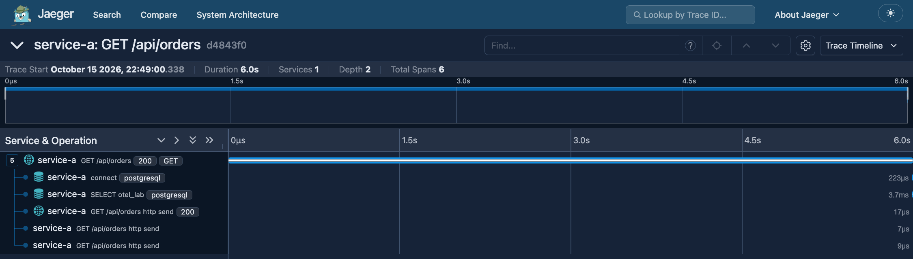

## 1. Alcance del Game Day

El Game Day se aplica sobre la arquitectura del laboratorio anterior: service-a (órdenes) llama por
HTTP a service-b (inventario), ambos usan PostgreSQL, y todo está instrumentado con OpenTelemetry y
observado con Prometheus, Grafana, Jaeger y Loki. El objetivo no es causar fallos al azar, sino
**poner a prueba hipótesis explícitas** (Basiri et al., 2016), en un **entorno local aislado** (Docker
sobre Colima) y con condiciones de aborto y rollback definidas antes de inyectar cualquier fallo.

Tabla 1

Estado estable y reglas de seguridad

| Elemento | Definición |
|---|---|
| Estado estable | Carga abierta de 50 iteraciones/s con k6 (~55 req/s). En service-a: errores 5xx < 2% y p99 < 500 ms durante 2 min, verificados en Prometheus antes de inyectar |
| Condiciones de aborto | Errores 5xx > 5% o p99 > 5 s en service-a, evaluadas cada 10 s |
| Rollback | Automático al terminar, al abortar, ante un error del script o con Ctrl-C (`trap`) |
| Roles | Coordinador (decide abortar), operador de inyección, observador de SLIs y trazas, y escriba (bitácora) |

## 2. Hipótesis de fallo

Siguiendo los Principios de Chaos Engineering (s. f.), cada hipótesis fija una condición y un
comportamiento esperado medible (tabla 2).

Tabla 2

Hipótesis de fallo

| # | Hipótesis |
|---|---|
| H1 | En estado estable, **cuando** la red entre service-b y service-a agrega de 100 a 1000 ms de latencia, **esperamos que** service-a absorba la demora sin errores (timeout de 5 s) y que solo se degraden las rutas que dependen de service-b; `GET /api/orders`, que no lo llama, debe mantener su p99 < 100 ms |
| H2 | En estado estable, **cuando** service-b recibe una carga de CPU del 100% de su núcleo durante 5 min, **esperamos que** el p99 de la reserva suba sin pasar de 1 s, sin errores 5xx ni pérdida de telemetría |
| H3 | En estado estable, **cuando** service-b pierde la conexión con PostgreSQL durante 60 s, **esperamos que** service-b falle rápido (≤ 5 s, 503), que service-a responda 502 sin bloquearse y que el sistema se recupere solo en < 30 s |

## 3. Experimentos de caos diseñados

La tabla 3 define el tipo de fallo, el radio de impacto, la duración y el rollback de cada
experimento. Incluye la inyección local y su equivalente conceptual en Gremlin y LitmusChaos, las
plataformas que se usarían en un clúster.

Tabla 3

Diseño de los experimentos

| Exp. | Fallo | Inyección local · equivalente | Radio de impacto | Duración | Rollback automático |
|---|---|---|---|---|---|
| E1 (H1) | Latencia | `tc netem delay` con filtro `u32` hacia service-a · Gremlin *Latency*, Litmus `pod-network-latency` | Solo el enlace service-b → service-a | +100, +400 y +1000 ms, 2 min cada fase | `tc qdisc del` |
| E2 (H2) | CPU | `stress-ng --cpu 1 --cpu-load 100 --timeout 300s` en service-b · Gremlin *CPU*, Litmus `pod-cpu-hog` | Un contenedor (1 CPU) | 5 min | `--timeout` y `kill` |
| E3 (H3) | Partición de red | `iptables -A OUTPUT -d <IP PostgreSQL> -j DROP` en service-b · Gremlin *Blackhole*, Litmus `pod-network-partition` | Solo service-b → PostgreSQL | 60 s | `iptables -D` con `timeout` |

Cuando los tres pasen, el siguiente paso es la terminación aleatoria de réplicas al estilo de Chaos
Monkey (Litmus `pod-delete` en GKE), para validar la redundancia y la reprogramación de Kubernetes.

## 4. Métricas de observabilidad para verificar las hipótesis

Tabla 4

Señales de observabilidad por hipótesis

| # | SLI que mide el impacto (Prometheus) | Logs y trazas que confirman el comportamiento |
|---|---|---|
| H1 | p99 por ruta (`http_server_request_duration_seconds` por `http_route`), tasa de 5xx y solicitudes concurrentes (`http_server_active_requests`) | Sin "Error de red llamando a service-b" en Loki. En Jaeger, el span cliente hacia service-b crece y `inventory.reserve_stock` no |
| H2 | p99 de `POST /api/orders`, CPU de service-b (`process_cpu_time_seconds_total`) y `otelcol_exporter_send_failed_*` | `inventory.reserve_stock` crece pero sus spans SQL no (el cuello es la CPU, no la base de datos) |
| H3 | Tasa de 5xx por servicio, tiempo hasta el primer 503 y `db_client_connections_usage` | "service-b respondió con error" en service-a; spans `connect` con estado ERROR y reserva ≤ 5 s |

## 5. Ejecución del experimento E1 y resultados

E1 se ejecutó con `GameDay/chaos/exp1-latencia-red.sh`. La latencia se inyectó con `tc netem` desde un
contenedor auxiliar (`nicolaka/netshoot`) que comparte la red de service-b. El filtro limitó la demora
a los paquetes dirigidos a service-a: en una prueba previa con +200 ms, `POST /api/orders` subió de
8 a 230 ms y `GET /api/orders` se quedó en 4 ms. El script verificó el estado estable (p99 de 24 ms,
0% de errores) antes de inyectar.

Tabla 5

Resultados por fase del experimento E1 (medianas de p99)

| Fase | POST /api/orders (depende de B) | GET /api/catalog (depende de B) | GET /api/orders (no depende de B) | Concurrentes (máx.) | CPU service-a | 5xx (máx.) |
|---|---|---|---|---|---|---|
| Estado estable | 25 ms | 23 ms | 43 ms | 1 | 25% | 0.00% |
| +100 ms | 250 ms | 249 ms | 23 ms | 8 | 23% | 0.00% |
| +400 ms | 679 ms | 981 ms | 45 ms | 25 | 28% | 0.06% |
| +1000 ms (abortada) | 3092 ms | 2953 ms | **2401 ms** | **293** | 24% | 0.10% |
| Recuperación | 44 ms | 21 ms | 25 ms | 1 | 22% | 0.00% |

<i>Nota.</i> Prometheus, ventanas de 30 s, sin el calentamiento inicial. Las solicitudes en
cola al momento del rollback alcanzaron 7–9 s. Carga real: 55.1 req/s según k6.

<figure>
Figura 1

Latencia p99 por ruta y solicitudes concurrentes en service-a durante E1

<i>Nota.</i> Con +1000 ms, la ruta que no depende de service-b (rojo) se degrada igual que las que sí dependen, y las solicitudes concurrentes superan el límite de 40 hilos.
</figure>

<figure>
Figura 2

Traza de GET /api/orders durante la fase de +1000 ms (Jaeger)

<i>Nota.</i> 6.0 s de duración, pero su única consulta SQL tomó 3.7 ms y ocurrió al final: el resto fue espera por un hilo libre. Esta ruta no llama a service-b.
</figure>

Tabla 6

Comportamiento esperado frente a obtenido (H1)

| Aspecto | Esperado | Obtenido | Resultado |
|---|---|---|---|
| Errores 5xx | Sin errores adicionales | Máximo 0.10% | Se cumple |
| Rutas que dependen de B | p99 ≈ base + latencia | 250 ms (+100) y 679–981 ms (+400): amplificada, porque cada llamada cruza el enlace más de una vez | Se cumple, con amplificación |
| `GET /api/orders` | p99 < 100 ms | 23–45 ms hasta +400; **2.4 s con +1000 ms** | **Se refuta** |
| Saturación de service-a | Sin saturación | 293 concurrentes frente a 40 hilos | Se refuta |
| Seguridad | Aborto y rollback automáticos | Aborto a los 30 s (p99 = 7.25 s) y rollback inmediato | Funcionó |
| Recuperación | Vuelta al estado estable | Cola vacía en < 10 s; p99 normal a los ~40 s | Se cumple |

H1 **se sostiene hasta +400 ms y se refuta con +1000 ms**. La ley de Little lo explica (Little, 1961):
las solicitudes concurrentes equivalen al flujo de llamadas por su duración. Con unas 45 llamadas/s a
service-b, +400 ms deja 45 × 0.4 ≈ 18–25 en curso (se midieron 25), dentro de los 40 hilos. Con
+1000 ms se necesitan ≈ 45, el límite se supera y la cola crece sin control.

## 6. Reflexión: debilidad sistémica y remediación

El experimento reveló una **falta de aislamiento (*bulkhead*) entre dependencias**. Todos los
endpoints síncronos de service-a comparten un grupo de 40 hilos. Cuando service-b se vuelve lento, sus
llamadas retienen los hilos y las rutas sin relación con service-b esperan en la misma cola: una
degradación parcial se vuelve una falla en cascada (Nygard, 2018). El timeout de 5 s hacia service-b
no protege, porque es diez veces el objetivo de latencia.

El experimento también expuso dos puntos ciegos de observabilidad:

- **Los errores no pasaron de 0.10%**, así que una alerta por tasa de errores no se habría disparado.
- **La CPU se mantuvo en ~24%**, así que un autoescalado por CPU tampoco habría reaccionado.

La única señal que anticipó el colapso fue la **saturación**: las solicitudes concurrentes pasaron de
25 a 293 en menos de un minuto.

Tabla 7

Remediaciones propuestas y métrica de éxito al repetir E1

| Remediación | Cómo | Métrica de éxito |
|---|---|---|
| Presupuesto de tiempo | Timeout hacia service-b de 5 s a 800 ms, sin reintentos | p99 de `POST /api/orders` ≤ 1 s con +1000 ms |
| Circuit breaker | Abrir el circuito ante latencia o errores altos hacia service-b | Concurrentes < 40 durante la inyección |
| Aislamiento (*bulkhead*) | Semáforo de 20 llamadas simultáneas a service-b, o endpoints asíncronos con `httpx.AsyncClient` | p99 de `GET /api/orders` < 100 ms en todas las fases |
| Descarte de carga | `uvicorn --limit-concurrency`: responder 503 en lugar de encolar | Latencia de cola < 1 s |
| Alertas de saturación | Alertar sobre `http_server_active_requests` > 30 y el p99 por ruta | Alerta en < 30 s en la fase de +1000 ms |

Desde la antifragilidad (Taleb, 2012), el valor del Game Day es convertir la falla en aprendizaje: la
debilidad apareció en un entorno controlado, con aborto y rollback probados, y no en un incidente real.
El ciclo se cierra repitiendo E1 después de cada remediación como prueba de regresión, y avanzando
luego a E2 y E3 (Rosenthal & Jones, 2020).

## Referencias

Basiri, A., Behnam, N., de Rooij, R., Hochstein, L., Kosewski, L., Reynolds, J., & Rosenthal, C. (2016). Chaos engineering. *IEEE Software, 33*(3), 35–41. https://doi.org/10.1109/MS.2016.60

Gremlin. (s. f.). *Gremlin documentation: Attacks*. https://www.gremlin.com/docs

LitmusChaos. (s. f.). *Litmus documentation*. https://docs.litmuschaos.io/

Little, J. D. C. (1961). A proof for the queuing formula: L = λW. *Operations Research, 9*(3), 383–387. https://doi.org/10.1287/opre.9.3.383

Nygard, M. T. (2018). *Release it! Design and deploy production-ready software* (2.ª ed.). Pragmatic Bookshelf.

Principles of Chaos Engineering. (s. f.). *Principles of chaos engineering*. https://principlesofchaos.org/

Rosenthal, C., & Jones, N. (2020). *Chaos engineering: System resiliency in practice*. O'Reilly Media.

Taleb, N. N. (2012). *Antifragile: Things that gain from disorder*. Random House.

